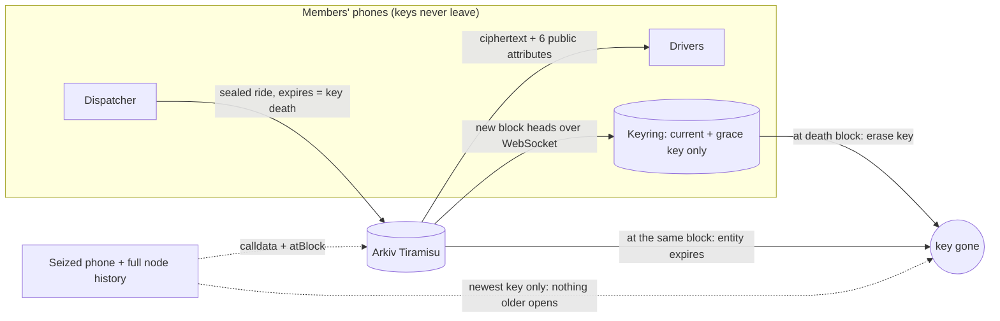
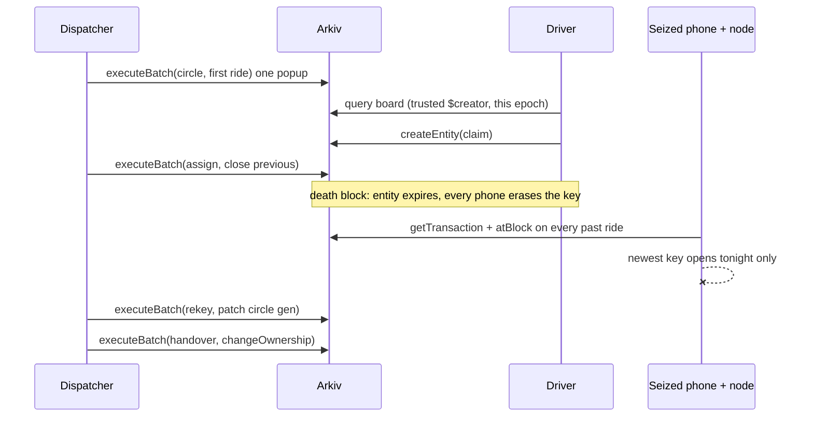

# Rasure

**The dispatch board that forgets on schedule.**

[](LIVE_URL) [](https://github.com/0xkinno/rasure/actions/workflows/ci.yml) [](LICENSE) [](https://tiramisu.explorer.arkiv.network) [](https://www.npmjs.com/package/@arkiv-network/sdk)

Rasure is a ride board for volunteers who drive survivors of domestic violence to safety. It truly forgets: a phone taken tonight cannot read last night's pickups, even by someone holding the whole chain.

<!-- headline:start -->
On Tiramisu, **294 of 300** public entities that had expired still returned their full payload from history. An expired record is gone from the board. It is not gone from the chain.
<!-- headline:end -->

A night dispatcher posts pickups for volunteer drivers. Each pickup is sealed under a key that every phone erases at the same block where Arkiv expires the record. We found that on Arkiv an expired entity's payload stays in its creation transaction, so expiry hides a record and does not forget it. Rasure binds Entity Expiration to key destruction to close that gap.

| | |
|---|---|
| **Live app** | [LIVE_URL](LIVE_URL) (no wallet needed to explore) |
| **For judges** | [`/judge`](LIVE_URL/judge) and [JUDGE.md](JUDGE.md): 60 seconds, 3 minutes, 10 minutes |
| **Seizure Drill** | [`/drill`](LIVE_URL/drill): attack the history yourself |
| **Demo video** | [VIDEO_URL](VIDEO_URL) (under 3 minutes) |
| **Read it without us** | [`reader.html`](LIVE_URL/reader.html), [`examples/raw-drill.mjs`](examples/raw-drill.mjs) (no SDK), the [CLI](scripts/rasure.ts), a `curl` |
| **Data contract** | [arkiv/schema.md](arkiv/schema.md) |
| **Friction report** | [arkiv/friction.md](arkiv/friction.md) |
| **Evidence** | [arkiv/evidence.md](arkiv/evidence.md) · [arkiv/wallets.md](arkiv/wallets.md) · [docs/FACTS.json](docs/FACTS.json) |
| **Tracks** | Privacy (primary) · Security · Open Source · Censorship Resistance |

| Board | Seizure Drill |
|---|---|
|  |  |
| **What a stranger sees** | **Proof** |
|  |  |

---

## 23:40, Pune

Meera Kulkarni runs night dispatch for a network of volunteer drivers. They take women leaving violent homes to a shelter or a One Stop Centre, usually between eight in the evening and two in the morning.

At 23:40 a driver calls her, shaking. The man whose wife she drove an hour ago caught up with her at a petrol pump and took her phone.

Meera's first question is not about the phone. It is about the list on it. On every shared board she has used, that list goes back weeks: pickup points, times, who went where. An expired post disappears from the screen, so it feels gone.

On Rasure, the answer is short. That phone can read tonight's rides and nothing older. Last week's pickups are sealed under keys that no longer exist anywhere, on any phone, and Arkiv has expired the records that held them. See [MOMENT.md](MOMENT.md).

## The problem

The law already knows a shared database is dangerous for survivors. US victim-service providers are barred from disclosing the people they serve and from putting client data into shared systems. A ride board shared between drivers is a shared database. Whatever it held can be read later by whoever gets hold of a phone or a server.

| What is true | Source |
|---|---|
| Victim service providers may not disclose personally identifying information about the people they serve | [34 U.S.C. 12291(b)(2)(B)](https://www.law.cornell.edu/uscode/text/34/12291) |
| They may not enter client-level data into the shared homeless database, and must use a separate comparable database | [NNEDV Safety Net](https://www.techsafety.org/comparable-database-101) |
| Advocates plan for abusers who monitor and take phones | [NNEDV Safety Net](https://www.techsafety.org/) |
| About 51,100 women and girls were killed by an intimate partner or family member in 2023 | [UN, 25 November 2025](https://turkiye.un.org/en/node/306761) |

## What we found on Arkiv

**Expiry hides. It does not forget.** Everyone building on Arkiv, and the Privacy track itself, treats Entity Expiration as the privacy control. We tested what it actually does.

1. **The payload lives in the transaction.** Every write is a call to `0x4400…0044`, and the payload travels uncompressed in its input. We created a probe, waited for it to expire, confirmed `getEntity` found nothing, then recovered the payload byte for byte from its creation transaction [`0xf3f506c0…`](https://tiramisu.explorer.arkiv.network/tx/0xf3f506c0140ad1b298c052ff3797d7ba9a9fa7a7651fd28643c9e54cca098ba6). Source: `$payload` in SDK 0.8.1 `src/attr/attributes.ts`, `execute()` in `src/entity/operations.ts`.
2. **History queries return expired entities.** `atBlock` reads returned the entity and its payload up to its last live block. The node answered a read at block 1.
3. **It is true across the network, not just for us.** We sampled public entities from every app on Tiramisu that were alive at a past block and have since expired. Counts only: no content, creator or app is printed.

<!-- wild:start -->
| Expired how long ago | Sampled | Still returned payload | Readable as plain text or JSON |
|---|---|---|---|
| about 20 minutes | 300 | 294 | 12 |
<!-- wild:end -->

Arkiv's own agent guidance warns builders not to promise erasure. Rasure is the first app we know of that acts on it.

Reproduce:

```bash
npx tsx scripts/discovery/d1-calldata.ts     # create, wait for expiry, recover from calldata
npx tsx scripts/discovery/d2-atblock.ts      # read the expired entity from history
npx tsx scripts/expiry-audit.ts --back=600 --max=300
```

## The solution

In Meera's words:

1. **I post a ride.** My phone seals it under tonight's key before anything leaves it.
2. **Arkiv holds only ciphertext,** and its Entity Expiration is the block where tonight's key dies.
3. **Drivers' phones open it.** They filter by area with a tag that changes every few hours, so nobody can follow a place across nights.
4. **At the death block, every phone erases the key and Arkiv expires the record.** Same block. Nothing to remember to delete.
5. **If a phone is lost, I rekey.** The remaining drivers get a fresh chain; the lost phone reads nothing written after that.
6. **When my shift ends, I hand the network over.** The morning dispatcher holds it from that block on. Rides I write afterwards no longer count.
7. **Our funder sees how many rides we served,** signed by me and kept alive by them, with no person, place or time in it.

## Explore it in 2 minutes

No wallet needed for steps 1 to 4.

1. **[`/drill`](LIVE_URL/drill)**, press *Run the seizure*. Three boards hold the same rides; one phone is seized; the full history is replayed from Arkiv. Watch which rows open.
2. **[`/explorer-view`](LIVE_URL/explorer-view)**: pick a live ride. You see what any stranger sees: six attributes, ciphertext, the decoded creation transaction. Open the same entity in the Arkiv Data Explorer.
3. **[`/proof`](LIVE_URL/proof)**: copy a `curl`, run it in a terminal, get the same answer without our site.
4. **[`/board`](LIVE_URL/board)**: the demo network is live. Watch the key-death strip count down; at zero the oldest cards scrape away.
5. **With a wallet:** open a network, post a ride (one popup, a real Tiramisu transaction), claim it from a second wallet, assign it, then *Post as a stranger* and see it ignored by `$creator`.

## How it works



```text
epoch       0      1      2      3      4      5
key         k0 --> k1 --> k2 --> k3 --> k4 --> k5        one-way HKDF: no step backwards exists
ride in 2                 [ readable 2..3 ] x            key erased AND entity expired at start of 4
seized at 5                                     [k5]     opens epochs 4 (grace) and 5, never 0..3
rekey at 5                                      [k5'] -> the lost phone cannot follow k5' at all
```

### Where the guarantee lives

| Concern | Decided by | Why |
|---|---|---|
| When a record stops being served | Arkiv Entity Expiration | the network enforces it; no cron, no operator |
| When it stops being readable | the key ratchet on every phone | expiry alone leaves calldata and history |
| Who may post a ride | `$creator` and the circle's `$owner` at that block | set by the chain, not by a field anyone can write |
| What a stranger learns | six public attributes and padded ciphertext | checked on every entity by the leak audit |

## Product flow



## Why Privacy

**Who is exposed today:** a survivor whose pickup history sits on every phone and server that ever showed the board. Expiring the post does not help: the content stays in history and in the transaction.

**What changes from day one:** a lost phone reads at most two epochs. Nothing on the explorer names a person, a place or an exact time. The dispatcher sets every lifetime and nobody can stretch a ride's. Rekeying cuts a lost phone off completely.

## Why Security

**Who is misled today:** a driver shown a "pickup" that anyone could have written, including the abuser.

**What changes:** a ride counts only when its `$creator` is the circle's creator or held the circle at that block. Assignments count only from the ride's own dispatcher. Forged rides, forged assignments and replayed ciphertext are shown, labelled, and ignored.

## Why Open Source

**Who is blocked today:** any team that wants data on Arkiv to become unreadable when it expires. They would have to discover the gap and build the cryptography themselves.

**What changes:** `@rasure/core` gives any Arkiv app forward-secret payloads, rotating blind indexes, calldata recovery and rekeying, with a documented data contract, conformance tests and a reader written from the contract alone.

```ts
import { newChain, advance, currentKey, keyDeathBlock, seal } from "@rasure/core";
const ring = advance(newChain(circleId, clock), head).state;
const { epoch, chainKey } = currentKey(ring);
await wallet.createEntity({
  attributes: { project: "my-app", epoch: u64(epoch) },
  payload: await seal(chainKey, { circle: circleId, epoch, type: "ride" }, body),
  contentType: "application/vnd.rasure.sealed.v1",
  expires: ExpirationTime.atBlock(keyDeathBlock(clock, epoch)),
  flags: { readonly: true },
});
```

## Why Censorship Resistance

**Who is censored today:** a shelter network whose board lives on one operator's server, which can be switched off, subpoenaed or breached.

**What changes:** there is no Rasure database. Four clients read the same data with nothing from us: the web app, a one-file `reader.html` you can open from disk with any RPC, a CLI, and `raw-drill.mjs`, which reruns the whole seizure drill in plain JSON-RPC with no SDK.

## Why Arkiv

| If Rasure ran on | What breaks |
|---|---|
| Postgres or our own API | the operator holds the clock and the data; "expired" is a promise, and the server is one subpoena or breach from everything |
| IPFS | no expiry and no query: a pinned ride is readable forever and cannot be filtered by epoch or area |
| A subgraph | it indexes forever and someone must run it; expiry would be our code, not the network's |
| Arkiv alone, without Rasure | the board expires correctly, but every payload stays readable in history: the gap we measured |

Arkiv gives what Rasure cannot build alone: an expiry the network enforces at an exact block, authorship set by the chain, typed queries, history reads and live events. Rasure adds the one thing Arkiv does not do: make expired mean unreadable.

**Kept off Arkiv on purpose:** names, phone numbers, addresses, places, exact times, keys, seeds, the member list, and every plaintext byte.

## How we use Arkiv

Every feature below changes something a dispatcher, a driver or a stranger sees. File and line for each are in [SDK_SURFACE.md](SDK_SURFACE.md).

| Arkiv feature | How Rasure uses it, and why | What the user sees |
|---|---|---|
| **Entity Expiration per type** | rides, claims and assignments expire at `keyDeathBlock(epoch)` with `ExpirationTime.atBlock`; the circle is a 30-day lease; tallies live 90 days; rekeys live one epoch | cards scrape away at the same block the key dies |
| **Lifetime Extension** | the dispatcher's activity renews the circle lease; a network that stops operating disappears by itself | "Network active until block N" |
| **Creation flags** | every sealed record is `readonly`; rides refuse `permissionlessExtension` (stretching a ride past its key keeps only noise); tallies allow it so a funder can keep the service record alive | "Only the dispatcher sets lifetimes"; funder's extension shown |
| **Attributes vs payload** | at most six public attributes; `epoch` and `served` as `u64`; the area only as a rotating HMAC tag; all content sealed and padded | the stranger view: nothing personal |
| **Queries** | compound predicates, `$creator` OR-lists, `NOT` for forgeries, ranges on `epoch` and `$expiresAt` ("dies in the next 10 minutes") | board, ignored panel, countdown strip |
| **`createdBy()` / `ownedBy()`** | the circle anchor and "my claims" by creator; "networks I hold" by owner | network badge, my claims, my networks |
| **`$creator` / `$owner`** | trust from `$creator`; shift handover via `$owner` checked at the ride's block with `atBlock` | "written by" and "held by", separately |
| **`changeOwnership`** | the night dispatcher hands the network to the morning one, batched with a sealed handover record | handover banner; later rides by the old holder ignored |
| **`patchEntity`** | a rekey patches the circle's public `gen`, batched with the rekey entity | "Circle rekeyed at block N, generation 2" |
| **`deleteEntity`** | cancel a ride, withdraw a claim | gone from every board now, with the honest note that only key death makes it unreadable |
| **Batch writes** | network + first ride; assign + close; rekey + patch; handover + transfer: each must land together | one popup, both or neither |
| **History (`atBlock`)** | the drill, the audits, owner-at-block checks and the reader's rewind read the past on purpose | drill rows, rewind |
| **WebSocket entity events** | `watchEntityEvents` with no `fromBlock`; heads drive key death; transfers and deletes move the board | the board and the keys change live |
| **Direct JSON-RPC** | calldata recovery with `eth_getTransactionByHash`; a `curl` for every query | drill and proof pages |

**Outside the product, used to check it:** the Arkiv Data Explorer shows the same entities from Arkiv's own tool, and the Arkiv MCP server independently confirms every demo entity ([`proof/results/mcp-*.json`](proof/results)).

### One transaction per feature

<!-- txfeatures:start -->
Generated by `scripts/evidence.ts` from `proof/results`.
<!-- txfeatures:end -->

## Measured

<!-- facts:start -->
- D1: expired entity absent from live state, payload recovered from calldata byte for byte: true (tx `0xf3f506c0140ad1b298c052ff3797d7ba9a9fa7a7651fd28643c9e54cca098ba6`).
- D2: node answered a history query at block 1; payload returned at the last live block: true.
- Seizure drill, plaintext: 12 of 12 records exposed.
- Seizure drill, static_key: 12 of 12 records exposed.
- Seizure drill, ratchet: 2 of 12 records exposed.
- Seizure drill, rekey: 0 of 2 records exposed.
- Error directions: attacker opened 0 past records; legitimate member refused 0 of 4 live records.
- Leak audit: 60 entities, at most 6 public attributes, 0 plaintext creation transactions, pass: true.
- Wild-set audit (aggregate, partial run): 300 public entities that were live at block 738949 and have since expired were read at that block; 294 returned a payload; 12 parse as readable text or JSON.
- Cost: about 115072 gas and 0.00011507 GLM per ride.
<!-- facts:end -->

**Three boards, one seized phone.** The same rides were written three ways on Tiramisu and attacked with what a seized phone holds plus the full history. Plaintext and a single key leak everything. Rasure leaks only the current and grace epoch, by design, and nothing after a rekey.

**Misses we publish:** the current and grace epoch are readable from a seized phone (two epochs at most). The leak audit's entropy bar is set per payload length, because 256 random bytes measure about 7.2 bits per byte, not the 7.5 we first planned.

## Invariants

| Id | Invariant | Checked by |
|---|---|---|
| I1 | a record's `expiresAt` equals its key's death block | `I1: ride expiresAt is exactly keyDeathBlock(epoch)`; night watch, every 15 minutes |
| I2 | no chain key survives its death block on any phone | ratchet tests in `core.test.ts` |
| I3 | no public attribute outside the allowlist | `auditAttributes`, `scripts/leak-audit.ts` |
| I4 | a ride counts only from a trusted `$creator` | `partitionRides` tests; forged ride on chain |
| I5 | a ciphertext opens only in its own circle, epoch and type | AAD tests in `seal` |
| I6 | no creation transaction contains plaintext | `scripts/leak-audit.ts` |
| I7 | an assignment counts only from the ride's dispatcher | `rideStatus` tests; forged assign on chain |
| I8 | a seized phone cannot open an older epoch | `seizure drill: ratchet`, `rekey.test.ts` |
| I9 | after a handover, rides by the previous holder do not count | owner-at-block tests; live handover |

## What Rasure will not do

- Store a real name, number, address, place or exact time, in plaintext or hashed.
- Let anyone but the dispatcher extend a ride.
- Pretend deleting or expiring a record erases it. The interface says when a record becomes unreadable, and why.
- Fall back silently. When the public RPC rate-limits, the page says so and shows when it will retry.
- Deploy a smart contract. Every write is an Arkiv transaction signed by the user's own wallet.

## Read it without us

```bash
curl -s -X POST https://rpc.tiramisu.db-chain.testnet.arkiv.network -H 'content-type: application/json' \
  -d '{"jsonrpc":"2.0","id":1,"method":"arkiv_query","params":["project = str('"'"'rasure/v1'"'"') AND type = str('"'"'ride'"'"')",{"select":{"key":true,"creator":true,"owner":true,"expiresAt":true,"attributes":true},"limit":"0x64"}]}'

node examples/raw-drill.mjs          # the whole seizure drill, no SDK, no install
npx tsx scripts/rasure.ts board      # the live board from a terminal
```

## Kept alive on purpose

A public workflow ([`night-watch.yml`](.github/workflows/night-watch.yml)) runs every 15 minutes during judging. It posts one sealed ride per epoch on the demo network so the board is never empty, renews the network's lease, and checks I1 and the leak audit on every live entity. It uses the same SDK calls as the app. If it stops, the demo network empties itself within two epochs, as designed. Its log is in [`proof/watch`](proof/watch).

## Honest notes

| Part | Trusted? | Why |
|---|---|---|
| Ride content | No | sealed on the phone; Arkiv holds ciphertext |
| Who wrote what | No | `$creator` and `$owner`, set by the chain |
| When records die | No | Entity Expiration, enforced by the network |
| A member's phone | **Yes, for two epochs** | it can read the current and grace epoch; rekey cuts it off |
| The join link | **Yes** | it carries a chain key; hand it over in person; rekey if it leaks |
| `/api/drip`, `/api/rpc` | Barely | test GLM and a read-only relay used after a rate limit; neither writes an entity |
| Arkiv Tiramisu | **Yes** | it is a testnet; history retention was measured once, not guaranteed |

Public metadata remains visible: wallet addresses, timing to the block, rides per epoch, padded length bucket, which wallets published a device key. Erasure on a phone is as good as its storage: we overwrite our copy and cannot audit the operating system.

## Disclosures

Pre-existing work: none. Baseline commit: [`BASELINE_SHA`](https://github.com/0xkinno/rasure/commit/BASELINE_SHA), the first commit, 18 October 2026. AI assistance: Claude was used as a coding assistant. Every place, ride and wallet is synthetic test data; the persona is described in [MOMENT.md](MOMENT.md).

## Run it locally

```bash
git clone https://github.com/0xkinno/rasure && cd rasure
npm install
cp .env.example .env.local        # Hub access key and test wallets (never committed)
npm test && npm run typecheck
npm run dev --workspace @rasure/web
```

Who signs: your own wallet signs every write. The server signs only the test GLM drip.

## Repository map

| Path | What |
|---|---|
| `packages/core` | ratchet, seal, blind index, calldata recovery, drill, rekey, handover, queries, writes, reads |
| `apps/web` | the Next.js app and the one-file reader |
| `examples` | `raw-drill.mjs`: the drill with no SDK |
| `scripts` | discovery, seed, drill, rekey, audits, MCP check, facts, evidence, CLI |
| `arkiv` | schema, friction, wallets, evidence |
| `proof` | manifests, raw results, night-watch log |
| `docs` | FACTS.json and screenshots |

## License

MIT. Copyright 2026 0xkinno.