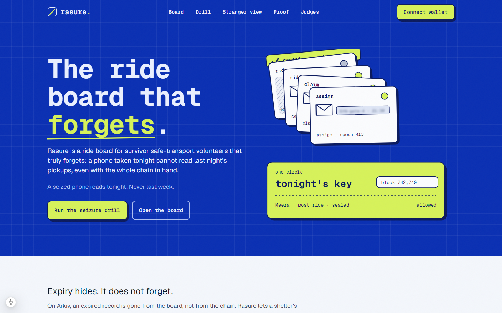
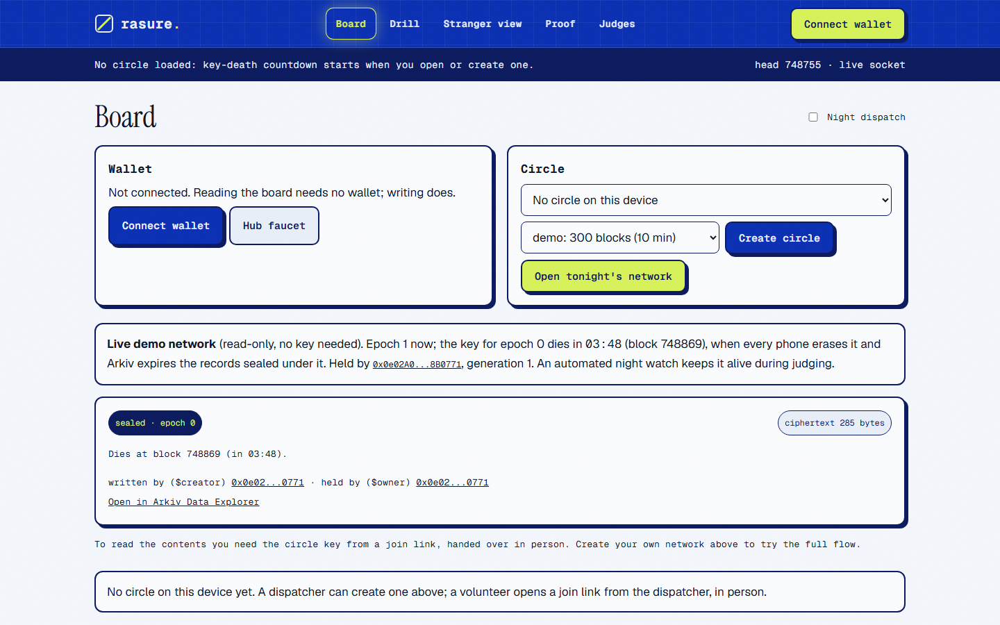
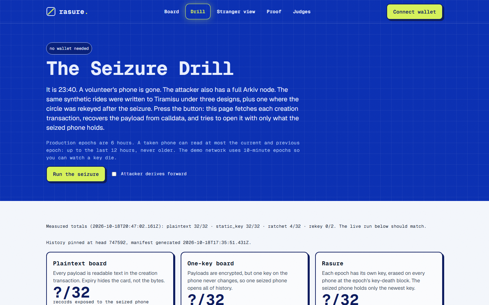
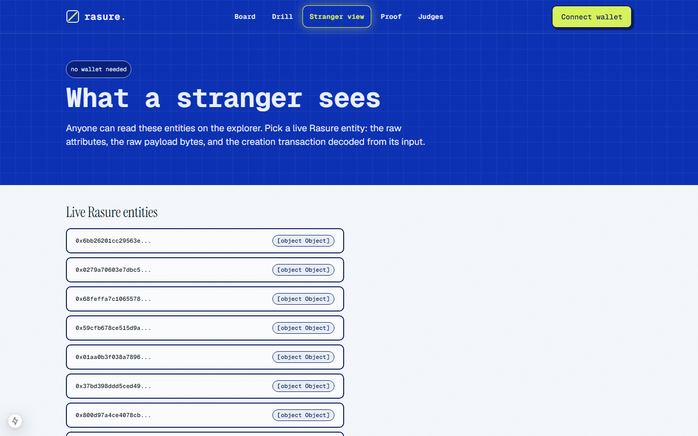
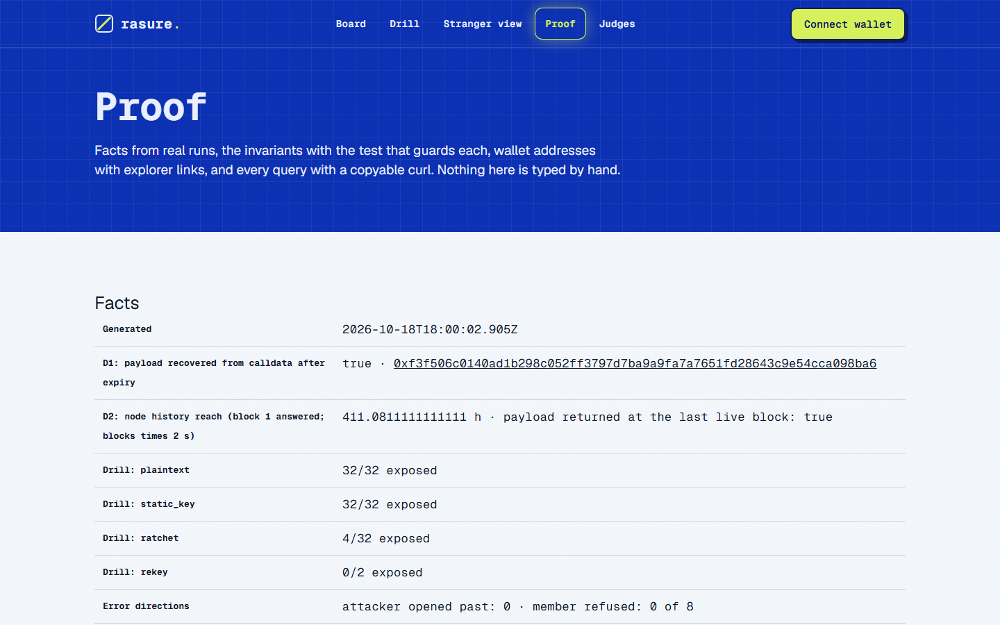
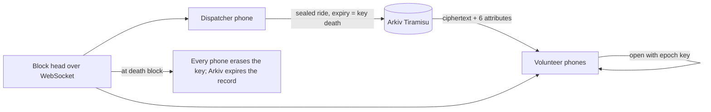
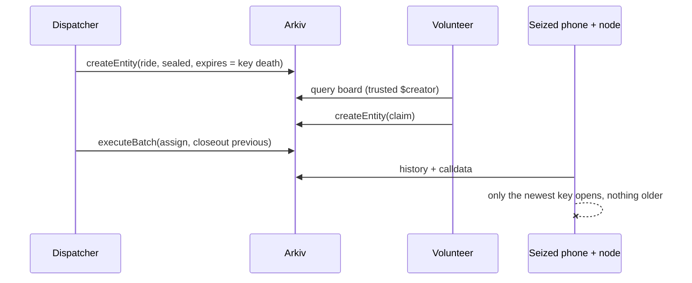

# Rasure

**The dispatch board that forgets on schedule.**

  

Rasure is a ride board for survivor safe-transport volunteers that truly forgets: a phone taken tonight cannot read last night's pickups, even with the whole chain in hand.

A night dispatcher posts pickups for volunteer drivers. Each pickup is sealed under a key that every phone erases at the same block where Arkiv expires the record. We found that on Arkiv an expired entity's payload stays in its creation transaction, so expiry hides a record and does not forget it. Rasure binds Entity Expiration to key destruction to close that gap.

| Link | Where |
|---|---|
| Live app | PENDING: set after the Vercel deployment (see [Run it locally](#run-it-locally) until then) |
| For judges | `/judge` and [JUDGE.md](JUDGE.md) |
| Seizure Drill | `/drill` (no wallet) |
| Demo video (2:50) | PENDING: recorded after deployment |
| Schema | [arkiv/schema.md](arkiv/schema.md) |
| Friction report | [arkiv/friction.md](arkiv/friction.md) |
| Evidence | [arkiv/evidence.md](arkiv/evidence.md) |
| Wallets | [arkiv/wallets.md](arkiv/wallets.md) |
| Tracks | Privacy, Security, Open Source, Censorship Resistance |

| Board | Drill | Stranger view | Proof |
|---|---|---|---|
|  |  |  |  |

## 23:40, Pune

Meera Kulkarni runs night dispatch for a network of volunteer drivers who take survivors of domestic violence to a shelter or a One Stop Centre. At 23:40 a driver's phone is taken by the abuser of the woman she just drove. Everything that phone can read about past pickups is now in the wrong hands. In most designs that means every ride it ever saw. In Rasure it means tonight's rides and nothing older. See [MOMENT.md](MOMENT.md).

## The problem

US law already tells victim service providers not to put survivor data into shared databases. A shared ride board is a shared database. Records that expire still leave copies.

| What is true | Source |
|---|---|
| Victim service providers may not disclose personally identifying information of the people they serve | [34 U.S.C. 12291(b)(2)(B)](https://www.law.cornell.edu/uscode/text/34/12291) |
| They cannot put client-level data into the shared homeless database and use a separate comparable one | [NNEDV Safety Net](https://www.techsafety.org/comparable-database-101) |
| Technology and abuse intersect; advocates plan for it | [NNEDV Safety Net](https://www.techsafety.org/) |
| About 51,100 women and girls were killed by an intimate partner or family member in 2023 | [UN release, 25 November 2025](https://turkiye.un.org/en/node/306761) |

## What we found on Arkiv

1. **D1.** Every write is a transaction to `0x4400000000000000000000000000000000000044` and the payload travels uncompressed in its input. After a probe entity expired, `getEntity` found nothing and the payload was recovered byte for byte from the creation transaction `0xf3f506c0140ad1b298c052ff3797d7ba9a9fa7a7651fd28643c9e54cca098ba6`.
2. **D2.** `atBlock` queries returned the entity and payload up to its last live block; the node answered a query at block 1, so no retention boundary was found.
3. **Wild set.** Other builders' expired entities are readable the same way (aggregate counts below).

Reproduce:

```bash
npx tsx scripts/keys.ts
npx tsx scripts/discovery/d1-calldata.ts
npx tsx scripts/discovery/d2-atblock.ts
npx tsx scripts/expiry-audit.ts --back=600 --max=300
```

## The solution

In Meera's words:

1. I post a ride. It is sealed on my phone under tonight's key before it leaves.
2. Arkiv stores ciphertext whose Entity Expiration is the block where that key dies.
3. Volunteers' phones open it. They filter by zone with a tag that changes every epoch.
4. At the death block every phone erases the key and Arkiv expires the record together.
5. If a phone is lost, I rekey the circle to the remaining members. The lost phone reads nothing after that.

## Explore it in 2 minutes

1. Open `/drill` and press Run the seizure (no wallet).
2. Open `/explorer-view` and read the verdict for a live entity (no wallet).
3. Open `/proof`, copy a `curl`, run it (no wallet).
4. Connect a wallet on `/board`, create a circle, post a ride, watch the transaction on the explorer.
5. Press Post as a stranger from a second wallet and see it ignored.

## How it works



```text
epoch:      0     1     2     3     4     5
key:        k0 -> k1 -> k2 -> k3 -> k4 -> k5      one-way (HKDF), no step backwards
ride sealed in epoch 2:   readable epochs 2 and 3, key erased and entity expired at the start of epoch 4
```

## Product flow



## Why Privacy

Who is harmed today: a survivor whose pickup history sits on any volunteer phone. What changes from day one: a lost phone reads two epochs at most, public attributes name no person or place, and the dispatcher controls expiry. The explorer shows ciphertext and six attributes.

## Why Security

Who is misled today: a volunteer shown a ride anyone could write. What changes: rides count only when `$creator` is a trusted dispatcher; assignments count only when the ride's dispatcher created them; forged entities are shown as ignored with their creator.

## Why Open Source

Who is blocked today: another team that wants forward-secret payloads on Arkiv. What changes: `@rasure/core` is a small library (ratchet, seal, blind index, calldata recovery, rekey) with a documented data contract and a one-file reader.

## Why Censorship Resistance

Who is censored today: a shelter whose board lives on one operator's server. What changes: anyone can read and query the data from Arkiv without our backend (`/reader.html`, the CLI, a `curl`).

## Why Arkiv

On Postgres or our own API the operator holds the clock and the data, and nobody can show that expired means expired. IPFS has no expiry. A subgraph indexes forever. Arkiv gives Entity Expiration that the user sets, `$creator` that no one can forge, queries on typed attributes, and live events. What stays off Arkiv: names, places, keys, membership, plaintext.

## How we use Arkiv

See [SDK_SURFACE.md](SDK_SURFACE.md) for each feature with file and line, and the list of what is not used.

## Measured

<!-- facts:start -->
- D1: expired entity absent from live state, payload recovered from calldata byte for byte: true (tx `0xf3f506c0140ad1b298c052ff3797d7ba9a9fa7a7651fd28643c9e54cca098ba6`).
- D2: node answered history down to block 1 (411 hours of history); payload returned at the last live block: true.
- Seizure drill, plaintext: 12 of 12 records exposed.
- Seizure drill, static_key: 12 of 12 records exposed.
- Seizure drill, ratchet: 2 of 12 records exposed.
- Seizure drill, rekey: 0 of 2 records exposed.
- Error directions: attacker opened 0 past records; legitimate member refused 0 of 4 live records.
- Leak audit: 11 entities, at most 6 public attributes, 0 plaintext creation transactions, pass: true.
- Wild-set expiry audit (aggregate): 300 expired public entities sampled at block 738949; 294 still return a payload; 12 parse as readable text or JSON.
<!-- facts:end -->

Misses named: the current and grace epoch are readable by design; the 7.5 bits per byte entropy bar in the plan is not reachable on 256 byte payloads (random bytes of that size measure about 7.2), so thresholds are per length and printed in the leak audit result.

## Invariants

| Id | Invariant | Test |
|---|---|---|
| I1 | `expiresAt` equals the key-death block | `I1: ride expiresAt is exactly keyDeathBlock(epoch)` |
| I2 | No chain key survives its death block | `core.test.ts` ratchet tests |
| I3 | No public attribute outside the allowlist | `auditAttributes`, `scripts/leak-audit.ts` |
| I4 | A ride counts only from a trusted `$creator` | `partitionRides` tests |
| I5 | A ciphertext opens only in its circle, epoch, type | seal tests (AAD) |
| I6 | No creation transaction contains plaintext | `scripts/leak-audit.ts` |
| I7 | An assignment counts only from the ride's dispatcher | `rideStatus` tests |
| I8 | A seized phone cannot open older epochs | `seizure drill: ratchet`, `rekey.test.ts` |

## What Rasure will not do

It will not store real personal data, plaintext or hashed. It will not claim erasure on a phone's storage beyond what the app overwrites. It will not simulate: when the RPC rate-limits, the UI says so with the retry time. It does not deploy a smart contract.

## Read it without us

```bash
curl -s -X POST https://rpc.tiramisu.db-chain.testnet.arkiv.network -H 'content-type: application/json' \
  -d '{"jsonrpc":"2.0","id":1,"method":"arkiv_query","params":["project = str('"'"'rasure/v1'"'"')",{"select":{"key":true,"attributes":true},"limit":"0x64"}]}'
npx tsx scripts/rasure.ts drill
```

## Honest notes

- The current and grace epoch are readable from a seized phone by design (two epochs at most).
- A leaked join link exposes its epoch and every later one until the circle is rekeyed.
- Public metadata remains: wallet addresses, timing, rides per epoch, padded length bucket, and which wallets published a device key.
- Erasure is only as good as the phone's storage.
- Tiramisu is a testnet; the node held full history when measured.

## Disclosures

AI assistant: Claude was used for coding assistance. Pre-existing work: none. All data is synthetic.

## Run it locally

```bash
git clone https://github.com/0xkinno/rasure && cd rasure
KINNO_EMAIL=<your github email> sh scripts/setup-git.sh   # only if you will commit
npm install
cp .env.example .env.local                         # add your Hub access key and test wallets
npm test && npm run typecheck
npm run dev --workspace @rasure/web
```

Who signs: your own wallet signs every write. The server signs only the test GLM drip.

## Repository map

| Path | What |
|---|---|
| `packages/core` | ratchet, seal, blind index, calldata recovery, drill, rekey, queries, writes, reads |
| `apps/web` | Next.js app and the one-file reader |
| `scripts` | discovery, seed, drill, rekey, audits, facts, CLI |
| `arkiv` | schema, friction, wallets, evidence |
| `proof` | manifests and raw results |
| `docs` | FACTS.json and screenshots |

## License

MIT. Copyright 2026 0xkinno.
